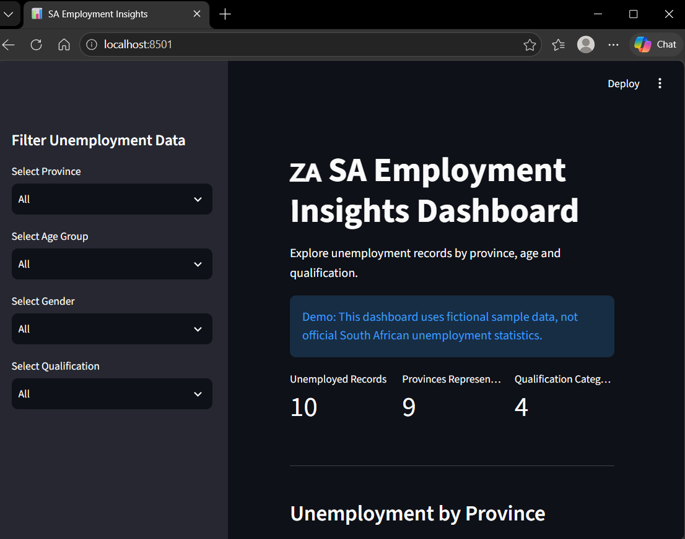
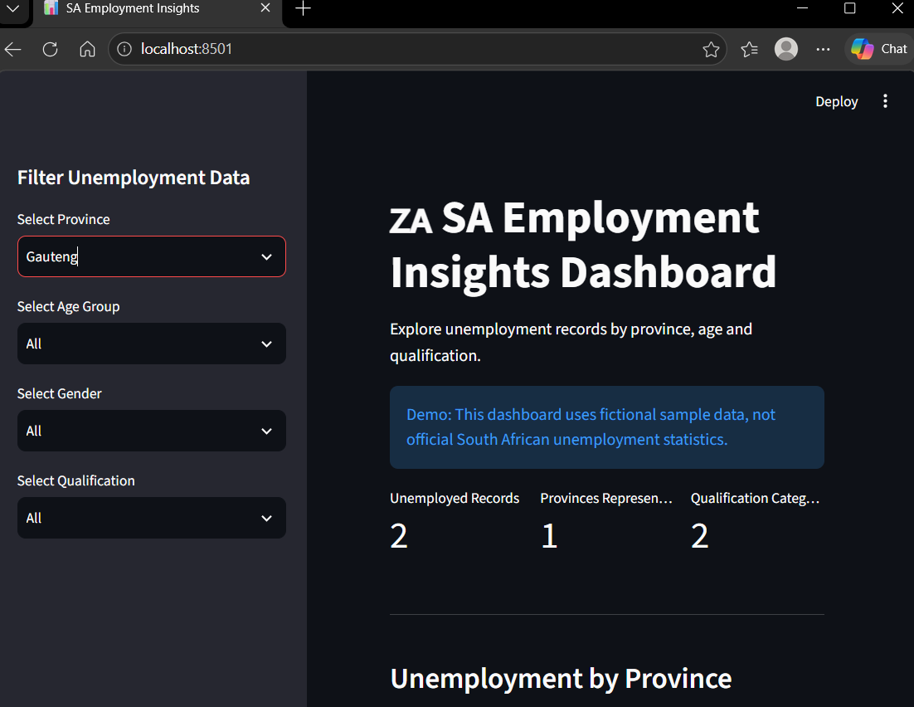
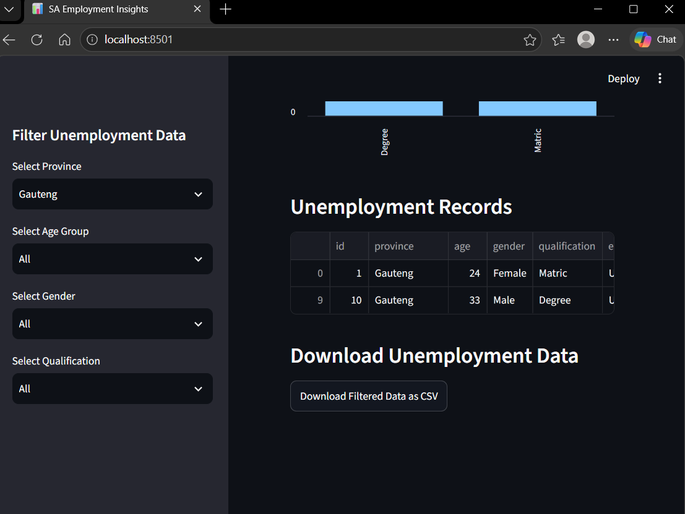

# SA Employment Insights & Opportunity Matcher

## Project Overview
This project analyses unemployment data in South Africa.

## Objectives
- Extract unemployment data.
- Clean data using Python and Pandas.
- Store data in SQLite.
- Analyse unemployment by province, age, and qualifications.
- Build a dashboard using Streamlit.

## Technologies
- Python
- Pandas
- SQLite
- Streamlit
- Git and GitHub

## Dashboard Screenshots

The following screenshots demonstrate the features of the SA Employment Insights Dashboard.

### Dashboard Overview

Displays unemployment records, summary statistics, and charts using fictional sample data.

### Interactive Filters

Users can filter records by province, age group, gender, and qualification.

### CSV Download

Users can export filtered unemployment records as a CSV file.

**Note:** This project currently uses fictional sample data for demonstration purposes. It does not represent official South African unemployment statistics.
